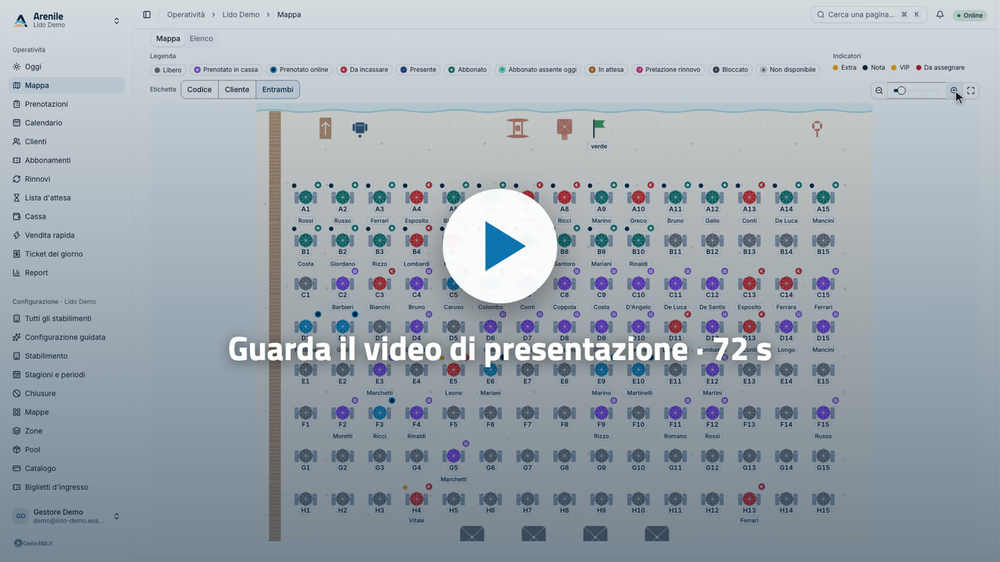

<div align="center">

<picture>
  <source media="(prefers-color-scheme: dark)" srcset="assets/brand/arenile/outlined/arenile-logo-horizontal-white.svg">
  
</picture>

# Arenile

**Il gestionale balneare gratuito per stabilimenti balneari e lidi, con codice sorgente disponibile.**
Mappa ombrelloni interattiva, prenotazione ombrelloni online senza commissioni, listini prezzi, cassa e abbonamenti stagionali: tutto in un unico binario self-hosted.

[](LICENSE)
[](https://go.dev)
[](https://react.dev)
[](https://github.com/coste360/arenile/pkgs/container/arenile)
[](https://docs.arenile.app/installazione/database/)
[](https://github.com/coste360/arenile/actions)
[](docs/release-notes/1.1.md)

**[Documentazione](https://docs.arenile.app)** · [arenile.app](https://arenile.app) · [Scarica](#scarica) · [Licenza](#licenza-e-marchio)

<br>

<a href="https://assets.coste360.it/assets/arenile-presentazione-v2.mp4" title="Guarda il video di presentazione di Arenile (72 secondi)">
  
</a>

</div>

---

**Arenile** è un software gratuito per la gestione di stabilimenti balneari, lidi, spiagge attrezzate e piscine all'aperto, sviluppato da [Coste360 SRL](https://www.coste360.it/). Il gestore lo installa sul **proprio** server: i dati restano suoi e nessuno trattiene commissioni sulle prenotazioni.

- **Mappa ombrelloni** con editor, vista del giorno in tempo reale tra cassa, spiaggia e online.
- **Prenotazione online** di ombrelloni e lettini da smartphone, incorporabile nel sito del lido (WordPress, Wix, qualsiasi sito) con una riga di codice; accessibile secondo le WCAG 2.1 AA.
- **Pagamenti con il tuo account Stripe**: zero commissioni alla piattaforma, conferma solo da webhook firmato.
- **Prezzi e policy** configurabili senza codice: periodi, pack, durate fisse, promo, convenzioni, cancellazioni.
- **Cassa, abbonamenti stagionali, report**, più stabilimenti e ruoli nella stessa installazione.
- **Nessun servizio esterno obbligatorio**: un binario Go, SQLite incluso, PostgreSQL facoltativo.

Arenile è fornito così com'è, senza garanzie (vedi [LICENSE](LICENSE)): per un'installazione verificata e con assistenza scrivi a [Coste360](https://www.coste360.it/contatti).

## Scarica

| | Dove |
|---|---|
| **Server** (VPS, mini PC, Raspberry Pi) | Immagine Docker `ghcr.io/coste360/arenile` · [guida all'installazione](https://docs.arenile.app/installazione/scegli-come-installare/) |
| **App desktop** (Windows, macOS, Linux) | [arenile.app/download](https://arenile.app/download/) |
| **App mobile per lo staff** (iPhone, Android) | [App Store](https://apps.apple.com/it/app/arenile/id6828818893) · [Google Play](https://play.google.com/store/apps/details?id=app.arenile.mobile) |

Su GitHub ci sono i sorgenti e le istruzioni di build; i pacchetti pronti dell'app desktop non vengono pubblicati qui.

**Prova in locale in un minuto** (compila l'immagine dai sorgenti, nessuna configurazione):

```bash
git clone https://github.com/coste360/arenile.git && cd arenile
ARENILE_BOOTSTRAP_OWNER_EMAIL=titolare@lido.test ARENILE_BOOTSTRAP_OWNER_NAME="Mario Rossi" \
ARENILE_BOOTSTRAP_OWNER_ORG="Lido Prova" ARENILE_ADMIN_PASSWORD=password-di-prova \
  docker compose up --build        # oppure: make up
```

Poi apri `http://localhost:8080/admin/` e accedi con le credenziali indicate. Questo `compose.yaml` è per lo sviluppo: per un server segui la [guida Docker](https://docs.arenile.app/installazione/docker/).

## Documentazione

Tutto il resto è su **[docs.arenile.app](https://docs.arenile.app)**, in italiano e in inglese:

- [Installazione e operatività](https://docs.arenile.app/installazione/): Docker, configurazione, HTTPS, backup, aggiornamenti
- [Guida del gestore](https://docs.arenile.app/gestore/): mappa, prenotazioni, prezzi, cassa, pagina pubblica e widget
- [API e webhook](https://docs.arenile.app/api/): riferimento OpenAPI, autenticazione, eventi
- [Sviluppo ed estensioni](https://docs.arenile.app/sviluppo/): architettura, repository, driver, contributi
- [Novità](https://docs.arenile.app/installazione/novita/) · [Domande frequenti](https://docs.arenile.app/installazione/domande-frequenti/)

Per chi sviluppa: [`AGENTS.md`](AGENTS.md) (comandi `make`, regole, definition of done), la [specifica](docs/spec/README.md), le [invarianti](docs/invariants.md) e gli [ADR](docs/adr/README.md). Il sito della documentazione si genera da [`docs-site/`](docs-site/) (`make docs-dev`).

## Contribuire e sicurezza

I contributi sono benvenuti: leggi [CONTRIBUTING.md](CONTRIBUTING.md) e il [Codice di condotta](CODE_OF_CONDUCT.md); alla prima pull request un bot ti chiede di firmare il [CLA](CLA.md). Per le vulnerabilità non aprire issue pubbliche: scrivi a **security@coste360.it** seguendo la [policy di segnalazione](SECURITY.md).

## Licenza e marchio

Arenile è **source available** con licenza **[Business Source License 1.1](LICENSE)** (SPDX `BUSL-1.1`):

- **gratuito** per installare e usare Arenile per gli stabilimenti che possiedi o gestisci direttamente;
- **non rivendibile**: offrirlo a terzi a pagamento o con altro vantaggio commerciale (hosting, SaaS, installazione, personalizzazione, assistenza, rivendita) richiede una licenza commerciale di Coste360 SRL (**info@coste360.it**);
- ogni versione passa ad **AGPL-3.0 o successiva** tre anni dopo il primo rilascio pubblico.

Il testo vincolante è il file [LICENSE](LICENSE); i casi pratici sono nella pagina [Licenza](https://docs.arenile.app/sviluppo/licenza/) e nell'[ADR 0007](docs/adr/0007-licenza-bsl.md). Il nome **Arenile** e il logo sono marchi di Coste360 SRL: vedi [TRADEMARK.md](TRADEMARK.md).

---

## In English

**Arenile** is a free, self-hosted, source-available management system for Italian beach establishments (*stabilimenti balneari*, lidos and beach clubs), developed by [Coste360 SRL](https://www.coste360.it/). It combines an interactive beach umbrella map, a cash desk, season passes, a configurable pricing and booking-policy engine, and a mobile-first online booking page for umbrellas and sunbeds (WCAG 2.1 AA) that can be embedded in any website. There are no booking commissions: online payments go through the operator's own Stripe account. It ships as a single Go binary and Docker image (`ghcr.io/coste360/arenile`) with SQLite by default and optional PostgreSQL. The desktop app is available from [arenile.app/download](https://arenile.app/download/) and the staff mobile app from the [App Store](https://apps.apple.com/app/arenile/id6828818893) and [Google Play](https://play.google.com/store/apps/details?id=app.arenile.mobile).

It is source-available under the [Business Source License 1.1](LICENSE): free for beach establishments that run it for themselves; offering it to third parties for a fee or other commercial advantage requires a commercial license from Coste360 SRL. Each version converts to AGPL-3.0 or later three years after its first public release. Documentation: [docs.arenile.app/en](https://docs.arenile.app/en/).
